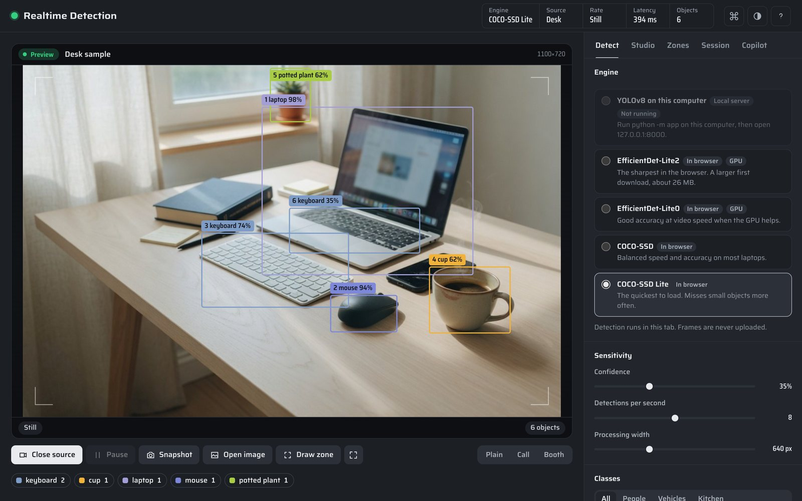
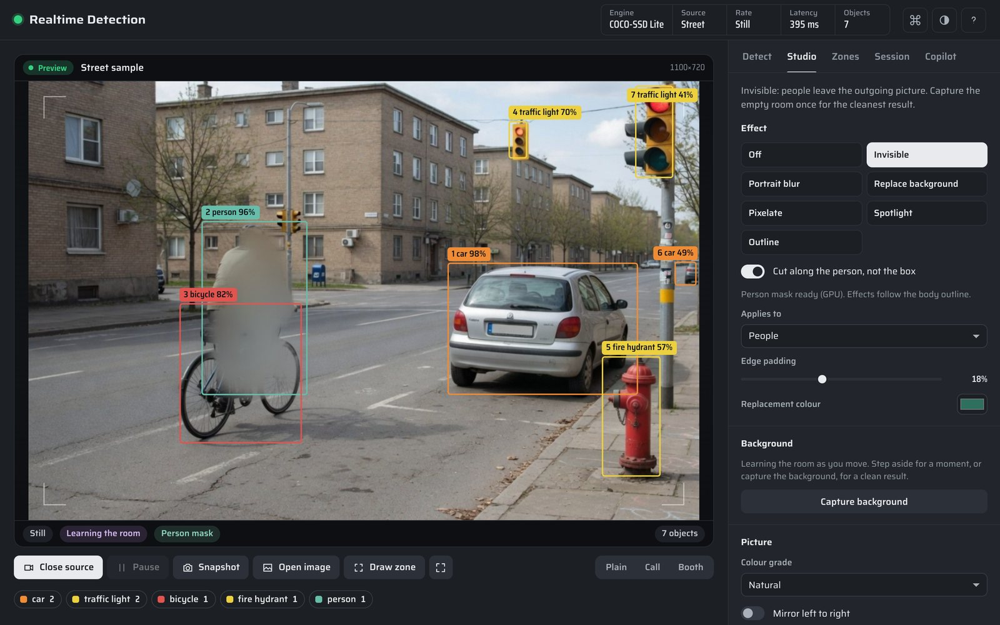
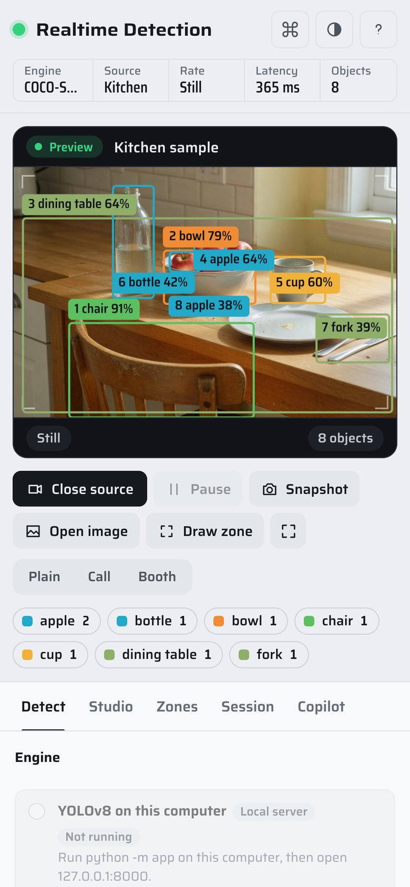

# Realtime Detection

Point a camera at the room and watch it name what it sees. Detection runs in your browser, or on YOLOv8 on your own computer. A studio can take people out of the picture you send to Zoom, Meet or Photo Booth.

**Try it:** [sebby1770.github.io/realtime-object-detection-web-app](https://sebby1770.github.io/realtime-object-detection-web-app/). Open a sample scene if you would rather not use your camera: [desk](https://sebby1770.github.io/realtime-object-detection-web-app/?sample=desk), [kitchen](https://sebby1770.github.io/realtime-object-detection-web-app/?sample=kitchen), [street](https://sebby1770.github.io/realtime-object-detection-web-app/?sample=street).



| Invisible, with a person mask | On a phone |
|---|---|
|  |  |

## What it does

- **Detect** objects from the 80 COCO classes, live from a camera, from sample scenes, or from images you open, one or many at a time. Boxes glide between detections, tracks keep their numbers, and each class keeps the same colour from the ColorChecker chart.
- **Choose an engine.** Three run in the browser; YOLOv8 runs on the local server. See [Engines](#engines).
- **Shape the outgoing picture** in the Studio: Invisible, Portrait blur, Replace background, Pixelate, Spotlight, and Outline. Effects follow a person mask from MediaPipe and fall back to soft box masks. Colour grades, mirror, auto frame, a name plate, a four-shot photo booth, and the looks Plain, Call, and Booth complete the set.
- **Send it** to a call: a clean-feed window to share, WebM recording, or OBS Virtual Camera through the local server. Zoom, Meet, Teams, Photo Booth, FaceTime, Discord, OBS, QuickTime, Slack, Webex, and Twitch each have setup steps in the Studio panel. The tally lamp turns red when the picture is on air.
- **Watch zones.** Draw up to three on the monitor. A zone alerts with an optional panned chime and saves a still when something new enters it.
- **Review the session**: latency and density charts, a map of where things are, a scene diary of arrivals and departures, history you can save as JSON, and zone-alert stills you can save as a gallery.
- **Ask the copilot** (Grok, ChatGPT, or Claude) about the scene. Replies stream in and stay in the panel, never in the outgoing picture. Sending the labels in frame, or one still, is opt-in.
- **Drive it from the keyboard**: ⌘K / Ctrl+K opens every command, and ? lists the shortcuts.

## Run it

### In the browser only

Open the [GitHub Pages site](https://sebby1770.github.io/realtime-object-detection-web-app/), or serve the repo root with any static server. The page works out which engines it can use. Without a local server, it runs EfficientDet through MediaPipe in the tab, or COCO-SSD where MediaPipe cannot start.

### With the local server (YOLOv8, virtual camera, copilot)

```bash
python3 -m venv .venv
source .venv/bin/activate
pip install -r requirements.txt
python -m app
```

Open [http://127.0.0.1:8000](http://127.0.0.1:8000). Ultralytics downloads the `yolov8n.pt` weights on first run, and the server warms them up in the background. Do not commit `*.pt` files.

To try the server without Ultralytics or a GPU, run it with a simulated detector:

```bash
python -m app --mock
```

`python -m app --help` lists `--host`, `--port`, `--reload`, and `--mock`.

### Use it as your camera

1. Choose **Invisible**, or the **Call** look. Step out of frame once, or press **Capture background** (`B`).
2. Press **Open clean feed** and share that window in Zoom, Meet, Teams, or Discord. Keep the main window visible while you share, because browsers slow down background tabs.
3. Photo Booth, FaceTime, QuickTime, and Zoom's camera picker need a camera device. Install [OBS](https://obsproject.com/) once, then:

```bash
pip install -r requirements-virtualcam.txt
```

Turn on **Send to virtual camera** and pick **OBS Virtual Camera** in the other app. OBS can also read `http://127.0.0.1:8000/api/studio.mjpg` as a media source.

## Engines

| Engine | Runs in | First download | Good for |
|---|---|---|---|
| YOLOv8n | Local server | 6 MB weights | The most accurate. Frames stay on this computer. |
| EfficientDet-Lite2 | Browser (MediaPipe, GPU) | about 26 MB | The sharpest in the browser. It finds the phone, book and fruit in the samples that the others miss. |
| EfficientDet-Lite0 | Browser (MediaPipe, GPU) | about 21 MB | The default without a server. Its download is shared with the studio's person mask. |
| COCO-SSD Lite | Browser (TensorFlow.js) | about 19 MB | The fallback where MediaPipe will not start. |

MediaPipe engines try the GPU first and fall back to the CPU. If one cannot start, the app switches to COCO-SSD Lite and says so. Downloads are cached, so later visits start in a second or two.

## Privacy

| | Browser engines (Pages) | Local server (YOLOv8) |
|---|---|---|
| Camera frames | Stay in the tab | Go to the FastAPI process on this computer |
| Blur people on the monitor | Overlay | Overlay, and people are also blurred before the frame is encoded |
| Copilot | Needs the local server | Your question goes to the provider you pick. Labels and one still go only if you turn them on. |
| Model files | Downloaded from jsDelivr and Google's model storage | Ultralytics weights on disk |

The page's Content-Security-Policy limits scripts to this site and jsDelivr, and connections to the model hosts. That also blocks MediaPipe's usage logging. API keys stay in this browser's storage and go only to the local server with each question; the server never logs or echoes them. Cameras need a secure origin, and `localhost` and `127.0.0.1` count.

## Keyboard

| Key | Action |
|---|---|
| ⌘K / Ctrl+K | Command palette |
| Space | Pause or resume detection |
| S | Save a snapshot |
| F | Fullscreen monitor |
| Z | Draw a zone (Esc cancels) |
| D | Invisible on or off |
| B | Capture the background |
| P | Photo booth |
| M | Mirror the picture |
| 1–5 | Detect, Studio, Zones, Session, Copilot |
| ⌘↩ / Ctrl+↩ | Ask the copilot |
| ? | Shortcut sheet |

## Configuration

Environment variables for the local server:

| Variable | Default | Meaning |
|---|---|---|
| `YOLO_MODEL` | `yolov8n.pt` | Ultralytics weights to load |
| `YOLO_CONFIDENCE` | `0.35` | Default confidence |
| `YOLO_IMAGE_SIZE` | `640` | Inference size |
| `YOLO_MOCK` | off | `1` uses the simulated detector (same as `--mock`) |
| `YOLO_WARMUP` | on | Load and warm the model at startup |
| `ALLOWED_HOSTS` | `localhost,127.0.0.1,testserver` | Accepted `Host` headers (DNS-rebinding guard); `*` turns the check off |
| `WS_ALLOWED_ORIGINS` | `http://localhost:8000,http://127.0.0.1:8000` | WebSocket and CORS allowlist |
| `MAX_FRAME_BYTES` | `524288` | Largest WebSocket frame |
| `MAX_UPLOAD_BYTES` | `8388608` | Largest uploaded image |
| `MAX_BATCH_IMAGES` | `12` | Images per batch request; extra ones are reported as `skipped` |
| `MIN_FRAME_INTERVAL_SECONDS` | `0.06` | Per-connection frame-rate limit, enough for the 15-per-second setting |
| `MAX_WS_CONNECTIONS` | `4` | Concurrent detection sockets |
| `STUDIO_FRAME_BYTES` | `2097152` | Largest virtual-camera frame |
| `COPILOT_GROK_MODEL` | `grok-4.7` | Default xAI model |
| `COPILOT_OPENAI_MODEL` | `chat-latest` | Default OpenAI model |
| `COPILOT_ANTHROPIC_MODEL` | `claude-opus-5-5` | Default Anthropic model |

If you open the server from another device on your network, add its address to `ALLOWED_HOSTS` and the page origin to `WS_ALLOWED_ORIGINS`.

## Development

```bash
pip install -r requirements-dev.txt
pytest
ruff check app tests
npm run test:js
```

CI runs all four without Ultralytics or Torch: YOLO is mocked, and no test downloads weights. `npm run test:js` syntax-checks every module in `static/` and runs the Node tests, including a fixture that keeps the Python and JavaScript trackers in agreement.

The frontend is plain ES modules with no build step, so GitHub Pages and FastAPI serve the same `index.html`. [docs/ARCHITECTURE.md](docs/ARCHITECTURE.md) maps the modules and the detection JSON.

## License

MIT © 2026 Sebastian Forbes. Saira is used under the SIL Open Font License (`static/fonts/OFL.txt`).
